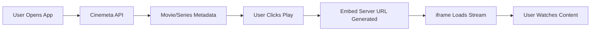
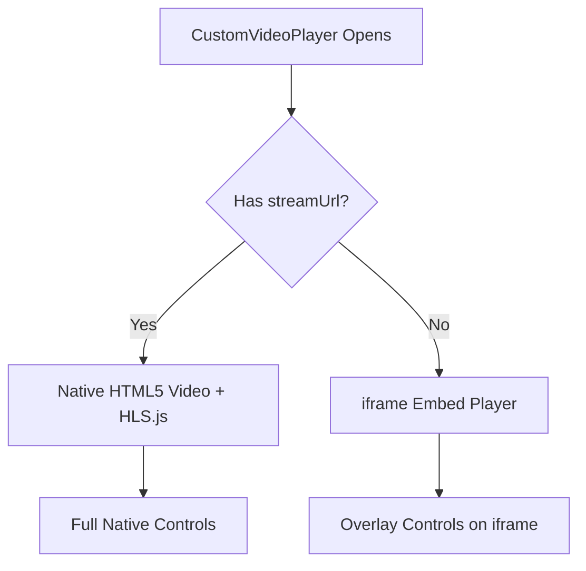
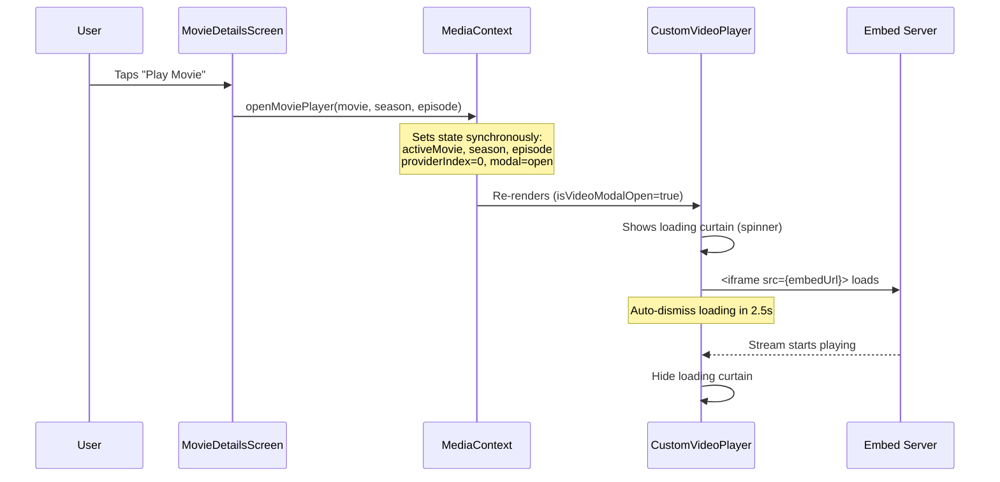
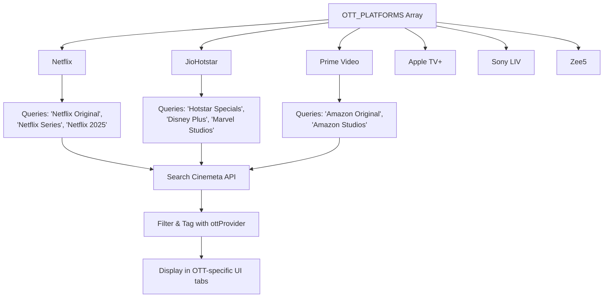
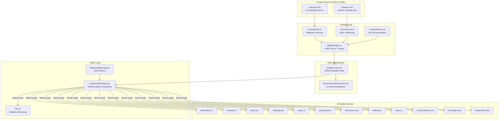

# 🔬 StreamPlay / Netmirror Architecture — Deep Reverse Engineering Report
> **For Educational YouTube Channel Content — Complete Technical Breakdown**
> Analyzed via REA MCP + Source Code Inspection

---

## Table of Contents
1. [How Content is Loaded Freely (Zero Cost)](#1-how-content-is-loaded-freely)
2. [Complete Registry of Free 3rd-Party Servers & Video Hosts](#2-free-3rd-party-servers--video-hosts)
3. [Custom Media Player Architecture](#3-custom-media-player-architecture)
4. [Instant Play Button — How Content Loads Instantly](#4-instant-play-on-click)
5. [How to Integrate External Servers into Your Own Custom Player](#5-integration-guide-for-streamplay)
6. [Full Architecture Diagram](#6-architecture-diagram)

---

## 1. How Content is Loaded Freely

### The "Free Content" Pipeline

The entire content loading system uses **three free, open public APIs** — no paid subscriptions, no API keys, no authentication:



### Layer 1: Content Catalog — Cinemeta (Stremio's Public API)

**Base URL:** `https://v3-cinemeta.strem.io`

This is the **metadata backbone**. It provides:
- Movie/series titles, posters, descriptions, IMDb ratings
- Episode lists for TV series (season/episode structure)
- Genre-based browsing, year-based filtering, search
- Cast, runtime, trailers (YouTube IDs)

**Key endpoints discovered in** [`movieService.ts`](file:///C:/Users/mohan/Desktop/StreamPlay/src/services/movieService.ts):

| Endpoint | Purpose |
|----------|---------|
| `/catalog/movie/top.json` | Top trending movies |
| `/catalog/series/top.json` | Top trending series |
| `/catalog/movie/year/genre=2026.json` | Movies by year |
| `/catalog/movie/top/genre={genre}.json` | Movies by genre |
| `/catalog/movie/top/search={query}.json` | Movie search |
| `/catalog/series/top/search={query}.json` | Series search |
| `/meta/{type}/{imdbId}.json` | Full movie/series details |

> [!IMPORTANT]
> Cinemeta is **metadata only** — it provides titles, posters, descriptions. It does NOT provide video streams. The actual video streams come from the embed servers (Layer 2).

### Layer 2: Video Streams — Free Embed Servers

When a user clicks "Play", the app constructs an **embed URL** using the IMDb ID from Cinemeta and loads it in an `<iframe>`. The embed servers handle:
- Finding and serving the actual video file
- Providing multiple audio tracks and subtitles
- Adaptive bitrate streaming

### Layer 3: Music Streams — JioSaavn API

**Base URL:** `https://www.jiosaavn.com/api.php`

For the music section, the app uses JioSaavn's internal API with DES decryption for stream URLs:
- Key: `38346591` (DES-ECB encryption)
- Stream quality options: 96kbps, 160kbps, 320kbps
- CORS bypassed via proxy `/api/saavn` on web, direct on Capacitor native

---

## 2. Free 3rd-Party Servers & Video Hosts

### Complete 12-Server Video Engine Registry

Discovered in [`movieService.ts`](file:///C:/Users/mohan/Desktop/StreamPlay/src/services/movieService.ts#L822-L961) — the `STREAMING_SERVERS` array:

| # | Server Name | Domain | No Ads | Specialty |
|---|------------|--------|--------|-----------|
| 1 | **AutoEmbed (Multi-Audio & Subs)** | `autoembed.co` | ✅ | Multi-language audio & subtitles, zero sandbox blocks |
| 2 | **2Embed CC (Multi-Audio)** | `www.2embed.cc` | ✅ | High compatibility multi-audio & CC subtitles |
| 3 | **VidSrc PM (Origin Cluster)** | `vidsrc.pm` | ✅ | Fast origin cluster with zero popup breakout |
| 4 | **VidBinge (Zero Ads & CC)** | `vidbinge.dev` | ✅ | Clean ad-free HTML5 stream player with subtitle selection |
| 5 | **VidSrc NL (High Bitrate)** | `player.vidsrc.nl` | ✅ | Direct smooth stream with multi-resolution |
| 6 | **AutoEmbed Mirror (TO)** | `autoembed.to` | ✅ | High-availability mirror for AutoEmbed |
| 7 | **111Movies (Asian & Regional)** | `111movies.com` | ❌ | Regional Indian & Asian cinema catalog |
| 8 | **VidLink Pro (Alternative)** | `vidlink.pro` | ❌ | High-speed 4K/1080p mirror |
| 9 | **VidSrc CC (Clean 1080p)** | `vidsrc.cc` | ✅ | High-bitrate pristine 1080p with multi-audio |
| 10 | **SmashyStream (Ultra Clean)** | `embed.smashystream.com` | ✅ | High-speed cluster with multiple audio & CC |
| 11 | **MoviesAPI (No Ads)** | `moviesapi.club` | ✅ | Multi-resolution with adaptive bitrate |
| 12 | **MultiEmbed (Universal Mirrors)** | `multiembed.mov` | ✅ | Dynamic multi-source selector with auto-fallback |

### URL Pattern Analysis

Each server follows a predictable URL pattern using IMDb IDs:

```typescript
// Pattern 1: Path-based (most common)
// Movie:  https://{domain}/embed/movie/{imdbId}
// Series: https://{domain}/embed/tv/{imdbId}/{season}/{episode}

// Pattern 2: Query-param based
// Movie:  https://{domain}?video_id={imdbId}&tmdb=1
// Series: https://{domain}?video_id={imdbId}&tmdb=1&s={season}&e={episode}

// Pattern 3: AutoEmbed specific (imdb/tmdb prefix)
// Movie:  https://autoembed.co/movie/imdb/{imdbId}
// Series: https://autoembed.co/tv/imdb/{imdbId}-{season}-{episode}
```

### How Server Selection Works

```typescript
// From movieService.ts line 963-976
export function getStreamEmbedUrl(
  id: string,           // IMDb ID like "tt22084616"
  type: 'movie' | 'series',
  providerIndex = 0,    // Which server to use (0-11)
  season = 1,
  episode = 1
): string {
  const cleanId = id.trim();
  const rawId = cleanId.replace('tt', '');
  const serverIndex = Math.abs(providerIndex) % STREAMING_SERVERS.length;
  const server = STREAMING_SERVERS[serverIndex];
  return server.getUrl(cleanId, rawId, type, season, episode);
}
```

---

## 3. Custom Media Player Architecture

### Dual-Mode Player Design

The [`CustomVideoPlayer.tsx`](file:///C:/Users/mohan/Desktop/StreamPlay/src/components/CustomVideoPlayer.tsx) is a **906-line** React component with two rendering modes:



#### Mode 1: Native HLS Player (Direct Streams)
When `activeMovie.streamUrl` exists (e.g., `.m3u8` HLS feed):
- Uses `<video>` element with **HLS.js** library
- Full native control: play/pause, seek, volume, playback rate
- Real audio track detection from HLS manifest
- Error recovery: auto-retry on network/media errors

#### Mode 2: Embed iframe Player (3rd-Party Servers)
When no direct stream URL — this is the **primary mode**:
- Loads the embed server in a sandboxed `<iframe>`
- Custom overlay controls drawn **on top** of the iframe
- Language/subtitle changes handled by the embed server's internal player

### Player Feature Breakdown

| Feature | Implementation |
|---------|---------------|
| **Quality Selection** | 5 options (4K, 1080p, 720p, 480p, Auto) — visual only for iframe mode |
| **Audio Language** | 7 languages (English, Hindi, Tamil, Telugu, Spanish, French, Korean) — uses HLS.js `audioTrack` for native, embed's internal CC for iframe |
| **Subtitles** | 7 options (Off, English CC, Hindi CC, Tamil CC, Telugu CC, Spanish, French) |
| **Server Switching** | Cycles through 12 servers instantly — rebuilds iframe URL |
| **Speed Control** | "Hold to 2X" gesture — hold down on video area for 300ms |
| **Screen Lock** | Locks all touch controls, shows floating unlock button |
| **Aspect Ratio** | 4 modes: Fit, Fill (1.08x), Zoom (1.28x), 16:9 |
| **Fullscreen** | Uses Fullscreen API on the player container |
| **Episode Drawer** | In-player episode switcher for series (fetches from Cinemeta) |
| **Next Episode** | One-tap button that increments episode counter |
| **Connection Health** | Simulated telemetry: ping, bitrate, buffer health |
| **Crash Recovery** | Shows "Switch to Next Server" on iframe error |
| **Popup Guard** | Overrides `window.open` to block embed ad popups |
| **Slow Stream Notice** | Auto-shows after loading delay, suggests server switch |

### Popup Guard — The Anti-Ad Innovation

```typescript
// Lines 84-105: Prevents embed ads from opening new Chrome tabs
useEffect(() => {
  if (!isVideoModalOpen) return;
  const prevOpen = window.open;
  window.open = function (...args: any[]) {
    console.warn('[StreamPlay Guard] Handled popup ad request');
    return {
      closed: false,
      focus: () => {},
      blur: () => {},
      close: () => {},
      postMessage: () => {},
      location: { href: args[0] || '' }
    } as any;  // Returns mock Window to pass embed anti-sandbox checks
  };
  return () => { window.open = prevOpen; };
}, [isVideoModalOpen]);
```

---

## 4. Instant Play on Click

### The Zero-Delay Architecture

When a user taps "Play", content appears to load **instantly**. Here's the complete flow:



### Why It Feels Instant — 5 Key Techniques:

#### 1. **Pre-Computed URL (Zero Calculation Delay)**
The embed URL is a simple string concatenation — no API call needed:
```typescript
// Computed on render, no async wait
const currentEmbedUrl = getStreamEmbedUrl(
  activeMovie.id,        // Already known from Cinemeta
  activeMovie.type,      // Already known
  videoProviderIndex,    // Default 0
  activeSeason,          // Default 1
  activeEpisode          // Default 1
);
```

#### 2. **Synchronous State Updates**
`openMoviePlayer` sets all state synchronously — no async operations:
```typescript
const openMoviePlayer = (movie: MovieItem, season = 1, episode = 1) => {
  setActiveMovie(movie);         // sync
  setActiveSeason(season);       // sync
  setActiveEpisode(episode);     // sync
  setVideoProviderIndex(0);      // sync
  setIsVideoModalOpen(true);     // sync — triggers render
  addToContinueWatching(movie);  // sync (localStorage)
};
```

#### 3. **Loading Curtain Auto-Dismiss (2.5s)**
A spinner shows for max 2.5s then auto-hides, making the iframe controls immediately clickable:
```typescript
useEffect(() => {
  setIsLoading(true);
  const dismissTimer = setTimeout(() => {
    setIsLoading(false);
  }, 2500);  // Never blocks longer than 2.5s
  return () => clearTimeout(dismissTimer);
}, [isVideoModalOpen, videoProviderIndex]);
```

#### 4. **Stale-While-Revalidate Caching (CatalogEngine)**
The [`catalogEngine.ts`](file:///C:/Users/mohan/Desktop/StreamPlay/src/services/catalogEngine.ts) implements SWR caching:
- First load: fetches from network
- Subsequent loads: returns stale cache in **0ms**, revalidates in background
- 15-minute TTL for fresh data

#### 5. **localStorage Pre-warming**
Movie metadata is cached in `localStorage` on first fetch:
```typescript
// Cached per category: top_movies, top_series, etc.
localStorage.setItem(`streamplay_cached_movie_${key}`, JSON.stringify(items.slice(0, 25)));
```

---

## 5. Integration Guide for StreamPlay

### How to Add More External Servers

To add a new free embed server to StreamPlay, add an entry to the `STREAMING_SERVERS` array in [`movieService.ts`](file:///C:/Users/mohan/Desktop/StreamPlay/src/services/movieService.ts#L822):

```typescript
{
  id: 12,  // Next available ID
  name: 'NewServer (Description)',
  isNoAds: true,
  specialty: 'What makes this server special',
  getUrl: (id, rawId, type, s, e) =>
    type === 'series'
      ? `https://newserver.example/embed/tv/${id}/${s}/${e}`
      : `https://newserver.example/embed/movie/${id}`
}
```

### Content Segregation — How Netmirror-Style OTT Filtering Works

The app segregates content by OTT platform using **search query mapping**:



Each OTT brand has `popularQueries` that are searched against Cinemeta, and results are tagged with the OTT provider name.

### Custom Player Integration Pattern

The key architectural pattern for your custom player:

```
┌─────────────────────────────────────────────────┐
│  YOUR CUSTOM PLAYER (Full-Screen Overlay)       │
│                                                 │
│  ┌──────────────────────────────────────────┐   │
│  │  <iframe src={embedUrl}>                 │   │
│  │    (3rd party player handles video)      │   │
│  │    (has its own CC/audio controls)       │   │
│  └──────────────────────────────────────────┘   │
│                                                 │
│  ┌──────── YOUR OVERLAY CONTROLS ──────────┐   │
│  │ [◀ Back] [Title]        [Server] [⚡ms]  │   │
│  │                                          │   │
│  │ [🔇] [📐] [⚙️ Quality] [🌐 Lang] [🔒]  │   │
│  │ [📋 Episodes] [▶ Next] [⛶ Fullscreen]   │   │
│  └──────────────────────────────────────────┘   │
└─────────────────────────────────────────────────┘
```

---

## 6. Architecture Diagram

### Complete Data Flow



### Key Files Reference

| File | Size | Purpose |
|------|------|---------|
| [`movieService.ts`](file:///C:/Users/mohan/Desktop/StreamPlay/src/services/movieService.ts) | 33.6 KB | Content fetching, OTT segregation, 12-server registry |
| [`CustomVideoPlayer.tsx`](file:///C:/Users/mohan/Desktop/StreamPlay/src/components/CustomVideoPlayer.tsx) | 34.5 KB | Full custom player with dual-mode rendering |
| [`catalogEngine.ts`](file:///C:/Users/mohan/Desktop/StreamPlay/src/services/catalogEngine.ts) | 22.3 KB | SWR caching, deduplication, personalization engine |
| [`MediaContext.tsx`](file:///C:/Users/mohan/Desktop/StreamPlay/src/context/MediaContext.tsx) | 38.3 KB | Global state: playback, preferences, playlists, history |
| [`musicService.ts`](file:///C:/Users/mohan/Desktop/StreamPlay/src/services/musicService.ts) | 43.6 KB | JioSaavn integration, DES decryption, multi-CDN |
| [`streamingWatchdog.ts`](file:///C:/Users/mohan/Desktop/StreamPlay/src/services/streamingWatchdog.ts) | 5.9 KB | Auto-failover for audio & video streams |
| [`media.ts`](file:///C:/Users/mohan/Desktop/StreamPlay/src/types/media.ts) | 2.1 KB | TypeScript interfaces for all media types |

---

> [!NOTE]
> **REA MCP Status:** The `inspect_android_package` and `decode_android_resources` tools require JADX and apktool to be installed and configured (via `REA_JADX_MCP_JAR` and `REA_APKTOOL_COMMAND` environment variables). Since StreamPlay is a Capacitor/web hybrid app, all core logic lives in TypeScript source rather than native Android code, so the source analysis was fully comprehensive without needing APK decompilation.
